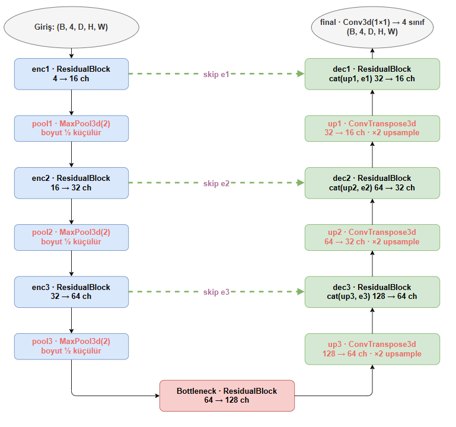
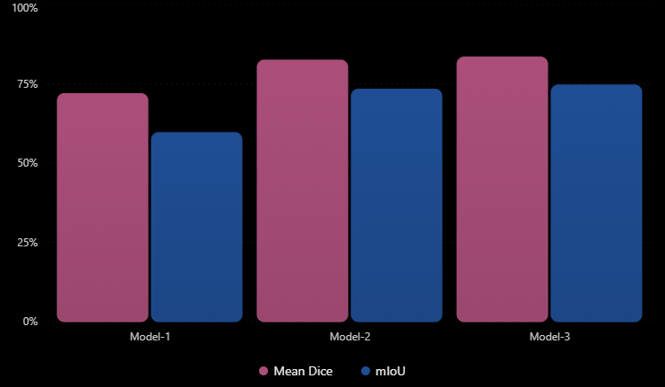
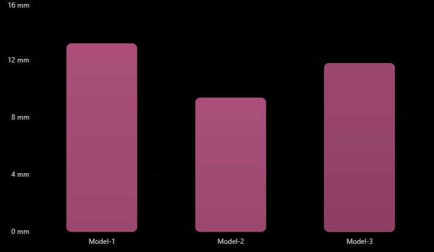
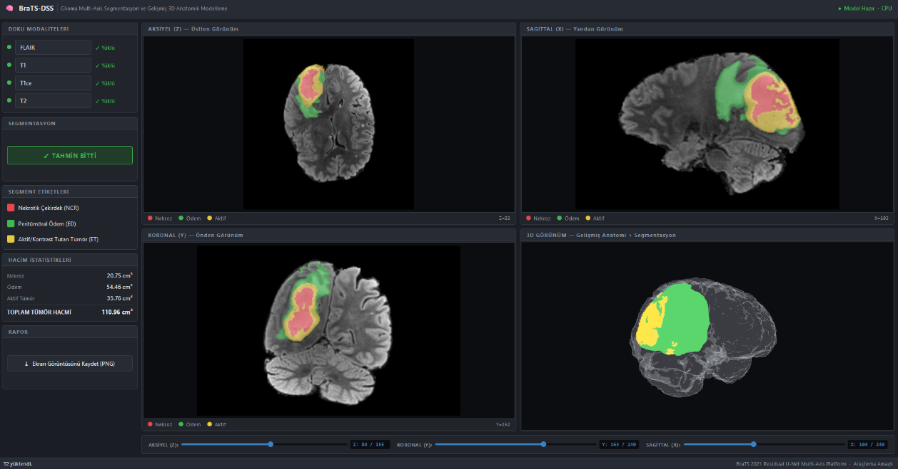

# NeuroSeg3D
**Deep Learning-Based 3D Brain Tumor Segmentation and Visualization**

NeuroSeg3D is a deep learning-based project for automated 3D brain tumor segmentation from multimodal MRI scans. Developed using PyTorch and the BraTS 2021 dataset, the system combines volumetric segmentation with an interactive desktop visualization interface.

### Download Windows Application

**[Download NeuroSeg3D for Windows (v0.1.0)](https://github.com/Kubraux/NeuroSeg3D/releases/download/v0.1.0/brain_tumor_segmentation_gui_app.zip)**

The Windows application includes a pretrained brain tumor segmentation model. No additional model training is required.

## Key Features

- **Multimodal MRI Processing:** T1, T1ce, T2, and FLAIR sequences.
- **3D Deep Learning:** Standard 3D U-Net and Advanced Residual UNet3D architectures.
- **Tumor Subregion Segmentation:** Necrotic Core (NCR), Peritumoral Edema (ED) and Enhancing Tumor (ET).
- **Multi-Planar Visualization:** Axial, sagittal and coronal MRI views.
- **Interactive 3D Visualization:** Tumor structure visualization using PyVista.
- **Volumetric Analysis:** Calculation of tumor subregion volumes.
- **Desktop GUI:** Developed using PyQt6 and PyVista.

## Methodology

Three model configurations were evaluated:

1. **Model-1:** Baseline 3D U-Net.
2. **Model-2:** 3D U-Net with class-weighted cross-entropy loss.
3. **Model-3:** Advanced Residual UNet3D incorporating residual connections.

The training pipeline includes intensity normalization, label remapping, AdamW optimization, automatic mixed precision (AMP), and early stopping.
### Advanced Residual UNet3D Architecture

The proposed architecture employs a 3D encoder-decoder
structure with residual blocks and skip connections
to preserve volumetric spatial information and
improve brain tumor subregion segmentation.

## Experimental Results

The following results were obtained on a held-out internal test split of the BraTS 2021 training data, not the hidden official BraTS challenge test set.

| Model | Mean Dice (%) | Mean HD95 (mm) | mIoU (%) |
|---|---:|---:|---:|
| Model-1 | 71.92 | 13.15 | 59.62 |
| Model-2 | 82.47 | **9.35** | 73.30 |
| Model-3 | **83.42** | 11.77 | **74.62** |

Model-3 achieved the highest mean Dice and mIoU scores, while Model-2 achieved the lowest mean HD95.
### Model Performance Comparison

Model-3 achieved the highest mean Dice (83.42%)
and mIoU (74.62%), whereas Model-2 obtained the
lowest mean HD95 (9.35 mm).

**Advanced Residual UNet3D Dice Scores:**

- Whole Tumor (WT): **85.07%**
- Tumor Core (TC): **84.55%**
- Enhancing Tumor (ET): **81.18%**

## Graphical User Interface

The PyQt6 and PyVista-based desktop application enables users to load multimodal MRI scans, run segmentation inference, examine the results across three anatomical planes, and interactively visualize the predicted tumor structure in 3D.

The interface also provides tumor volume calculations and PNG screenshot export.

### Application Preview

*NeuroSeg3D desktop interface for multimodal MRI
segmentation and interactive 3D tumor visualization.*
## Technologies

Python · PyTorch · 3D CNN · NumPy · NiBabel · PyQt6 · PyVista · BraTS 2021
## Dataset and Attribution

This project uses the **BraTS 2021 (RSNA-ASNR-MICCAI Brain Tumor Segmentation Challenge)** dataset for research on multimodal brain tumor segmentation. The dataset includes T1, contrast-enhanced T1 (T1ce/T1Gd), T2, and T2-FLAIR MRI volumes with expert-annotated tumor subregions.

- **Official challenge and access information:** [BraTS 2021 — CBICA, University of Pennsylvania](https://www.med.upenn.edu/cbica/brats2021/)
- **Dataset record and DOI:** [RSNA-ASNR-MICCAI-BraTS-2021 — The Cancer Imaging Archive](https://doi.org/10.7937/jc8x-9874)
- **Data availability:** BraTS MRI volumes and segmentation labels are not hosted in this repository. Users should obtain data from the official providers and comply with the applicable access and usage conditions.

### Dataset References

As requested by the official BraTS 2021 organizers, research using the dataset should cite the following three publications:

1. **Baid, U., et al. (2021).** The RSNA-ASNR-MICCAI BraTS 2021 Benchmark on Brain Tumor Segmentation and Radiogenomic Classification. *arXiv:2107.02314*. https://arxiv.org/abs/2107.02314
2. **Menze, B. H., et al. (2015).** The Multimodal Brain Tumor Image Segmentation Benchmark (BRATS). *IEEE Transactions on Medical Imaging, 34*(10), 1993–2024. https://doi.org/10.1109/TMI.2014.2377694
3. **Bakas, S., et al. (2017).** Advancing The Cancer Genome Atlas glioma MRI collections with expert segmentation labels and radiomic features. *Scientific Data, 4*, 170117. https://doi.org/10.1038/sdata.2017.117

The Cancer Imaging Archive (TCIA) additionally requests a dataset-specific citation:

4. **Baid, U., et al. (2023).** *RSNA-ASNR-MICCAI-BraTS-2021 Dataset*. The Cancer Imaging Archive. https://doi.org/10.7937/jc8x-9874

**Acknowledgement:** We thank the BraTS challenge organizers, participating institutions, expert annotators, and data contributors. These results are based in whole or in part on data generated by the TCGA Research Network (https://www.cancer.gov/tcga).

## Roadmap — NeuroSeg3D V2

The next version of NeuroSeg3D aims to introduce a modular model integration framework, allowing researchers to import compatible pretrained segmentation models and perform inference through a unified graphical interface.

Planned features:

- Custom pretrained model import and management
- Model compatibility and input validation
- Support for multiple segmentation architectures
- Side-by-side prediction visualization
- Quantitative evaluation when ground-truth masks are available
- Segmentation mask and analysis export

### Research Directions: Attention-Based Segmentation

Future experiments will investigate attention mechanisms for multimodal brain tumor segmentation, including attention-gated 3D U-Net variants and selected attention/Transformer-based architectures. These models will be evaluated against the current 3D U-Net and Advanced Residual UNet3D baselines using consistent data splits and segmentation metrics (Dice, mIoU, and HD95). The goal is to study potential improvements in tumor localization and subregion delineation while assessing computational cost and inference efficiency.

**Status:** Planned research; no attention-based models or associated results are included in the current release.

**V2 status:** Planned — not yet implemented.

## Project Status

- **Available now:** Project overview, architecture and GUI previews, experimental results, dataset references and a downloadable Windows desktop application with a pretrained segmentation model (v0.1.0).
- **Source code (planned):** The Python source code for preprocessing, model architectures, training, evaluation, inference and the PyQt6/PyVista interface will be added after the existing files have been recovered, organized, and checked for reproducibility and sensitive data. These source files are **not yet publicly available**.
- **Documentation (planned):** Installation requirements, reproducible execution instructions, and implementation details will be completed alongside the code release.
- **Future research (planned):** Attention-enhanced segmentation experiments and a modular model-import workflow for NeuroSeg3D V2.

## Contributors

- Kübra Yiğit
- Begüm Beraye Atalay (https://github.com/beraye)

**Academic Supervisor:** Dr. Öğr. Üyesi Gürkan Aydemir

**Institution:** Bursa Technical University, Department of Electrical and Electronics Engineering

## Disclaimer

This project was developed for academic research and educational purposes. It is not a clinically validated medical device and should not be used independently for medical diagnosis or treatment decisions.

